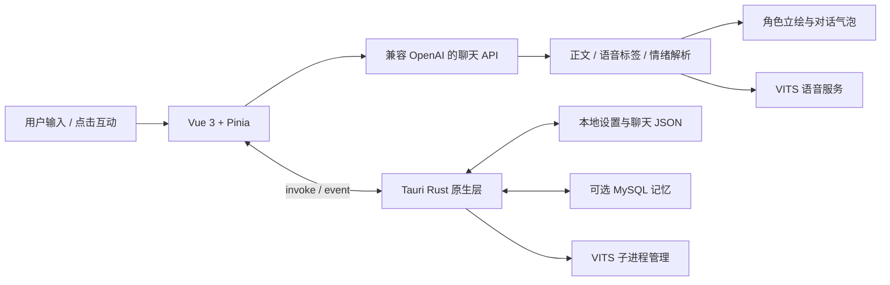

# Murasame 项目架构与实现说明

Murasame 是以角色陪伴为核心的 Windows AI 桌宠。本文描述当前仓库中的实现，安装和操作步骤见 [README](README.md)。

## 一、整体结构

项目由 Vue 前端、Tauri / Rust 原生层，以及按需启用的外部服务构成。桌宠不依赖 Spring Boot 后端。



| 层级 | 技术 | 职责 |
| --- | --- | --- |
| 界面 | Vue 3、TypeScript | 立绘、气泡、输入、设置与记忆面板 |
| 状态 | Pinia | 角色、API 配置、当前聊天记录 |
| 构建 | Vite、vue-tsc | 开发服务器、类型检查与静态资源构建 |
| 桌面 | Tauri 2、Rust | 窗口、托盘、系统对话框、文件与子进程 |
| 对话 | HTTP + SSE | 从配置的模型服务获取流式回复 |
| 语音 | VITS / BERT-VITS2 | 日语音频合成，由 Web Audio 播放 |
| 记忆 | MySQL | 角色独立的长期事实存储 |
| 分发 | Windows NSIS | 安装包构建 |

## 二、启动与状态恢复

1. `src/main.ts` 创建 Vue 应用并注册 Pinia。
2. `App.vue` 挂载时加载设置和近期聊天记录。
3. 设置存储恢复 API、角色、立绘及可选服务配置；旧版单角色数据会迁移为角色预设。
4. 前端通过 `read_image_base64` 读取本地立绘，组件缓存图片数据以减少重复读取。
5. 界面显示欢迎面板，并根据 API Key 是否配置提示下一步。
6. 开启 VITS 自启动时，前端请求 Rust 启动语音服务。

原生层在 `lib.rs` 中创建托盘、注册命令并设置窗口位置。主窗口配置为 500 × 600、透明、无边框、置顶且不显示在任务栏。

## 三、AI 对话链路

### 请求构建

`useAiChat.ts` 负责模型调用。普通消息由 `App.vue` 写入聊天存储，再交给对话模块。

对话请求包含角色 System Prompt、可选记忆内容、近期历史，以及本轮消息或互动提示。默认接口为 DeepSeek，但地址和模型均可配置。当前请求使用流式输出、`temperature: 0.8` 和 `max_tokens: 300`。

聊天存储最多保留 200 条消息；构造 AI 上下文时最多取近期 40 条。

### 回复解析

`useEmotion.ts` 优先识别 `[emotion:xxx]` 标签，再使用动作描述和正文关键词推断情绪。共支持 20 种情绪，名称与 `src/types/index.ts` 的 `Emotion` 联合类型一致。

`App.vue` 清理正文中的语音及情绪标签，更新气泡、表情和聊天记录，同时将完整回复交给语音模块，供语音标签提取和最新回复重播使用。

### 互动请求

摸头、戳肚子和闲置搭话也调用聊天模型，但可使用独立场景提示并跳过普通聊天历史。它们会产生正常的 API 请求，费用与可用性由所配置的模型服务决定。

## 四、角色与立绘

`settings.ts` 中的角色预设包含：

| 字段 | 作用 |
| --- | --- |
| `id` | 角色身份，同时用于长期记忆分组 |
| `name` | 显示名称 |
| `characterPrompt` | 人设、表达习惯与回复格式 |
| `sprites` | 情绪到图片列表的映射 |
| `vitsSpeakerId` | 当前角色的语音说话人 ID |

API 地址、模型、VITS 服务地址与 MySQL 连接等属于共享配置。

`PetStage.vue` 根据情绪选择图片；缺少对应立绘时回退到 `normal`。同一情绪有多张图片时，每 500 毫秒切换一帧。外层还有轻微的待机浮动动画。

设置面板支持逐张添加和文件夹批量导入。Rust 扫描文件名中的情绪英文名、中文别名及部分素材映射信息。丛雨与夏目两组原始素材通过 GitHub Releases 独立分发，源码和标准安装包不附带这些立绘。角色预设与本机素材路径需按需要配置；缺少默认文件时保持空立绘并显示占位提示。

切换角色会清空前端当前聊天列表。长期记忆按 `character_id` 保存，不随聊天列表清空而删除。

## 五、语音链路

`useVits.ts` 首先提取 `[voice:ja]...[/voice]` 中的日语。没有有效语音内容时，会清理正文并调用聊天 API 翻译为日语。

长文本会按标点和长度分段。前端根据模型类型访问：

```text
GET {vitsEndpoint}/voice/vits
GET {vitsEndpoint}/voice/bert-vits2
```

请求携带文本、说话人 ID、`lang=ja` 以及合成参数。音频通过 `AudioContext` 解码并逐段播放，取消令牌用于阻止旧任务继续播放。

`vits_manager.rs` 管理包含 `py310/python.exe` 与 `app.py` 的 VITS 目录：启动 Python 子进程、查询进程状态并在退出时停止进程。管理器的端口探测固定为 `127.0.0.1:23456`，而前端合成地址可配置，两者需要保持一致才能准确显示服务状态。

本仓库没有包含 Python 环境和语音模型，也没有直接管理 Style-Bert-VITS2 独立 API 服务的实现。

## 六、长期记忆

### 提取与检索

自动保存使用前端正则规则提取名字、喜好、生日、住址及明确要求记住的陈述。它并不是一次额外的 LLM 记忆提取调用。

对话前先获取近期记忆，再按关键词检索、去重，最多注入 12 条。查询使用 SQL `LIKE`，不是向量相似度检索。记忆服务异常时，前端尽量回退到普通聊天。

### 数据表

Rust 端通过 `mysql` crate 直连用户配置的数据库，自动创建 `desktop_pet_memories`：

| 字段 | 内容 |
| --- | --- |
| `id` | 自增主键 |
| `character_id` | 角色 ID |
| `content` | 记忆正文 |
| `source` | 记忆来源，如 `auto`、`manual` |
| `created_at` | 创建时间 |
| `updated_at` | 更新时间 |

记忆面板通过 Tauri 命令完成搜索、新增和删除。数据库必须由用户预先创建，连接账号需要相应表操作权限。

## 七、闲置行为与时间感知

`useIdleBehavior.ts` 每秒更新内部闲置计时。当聊天面板打开、正在生成回复或正在播放语音时暂停累计；用户交互会重置计时。

30 秒触发一次轻微表情变化；5、8、12、17、23 分钟进入不同的主动对话阶段。最后阶段之后每 6 分钟增加一个循环阶段。`useTimeGreeting.ts` 根据本地小时数划分清晨、午间、下午、夜晚和深夜。

其中「跳动」「绕鼠标」等文字是场景提示，用于生成角色的表达内容；没有对应的桌面路径运动控制实现。

## 八、本地数据与外部请求

`lib.rs` 通过 Tauri 的应用数据目录保存：

- `settings.json`：API、角色、立绘路径、VITS、MySQL 等设置。
- `chat_history.json`：近期聊天消息。

这些 JSON 文件没有由当前代码进行加密。聊天正文、人设、历史及检索到的记忆会随请求发送到用户配置的聊天 API；需要翻译时，清理后的正文也会发送。音频合成文本发送到所配置的 VITS 地址。

`.gitignore` 已排除运行时配置、个人数据、依赖目录、编译产物、Python 环境和常见模型权重。

## 九、模块索引

| 文件 | 职责 |
| --- | --- |
| `src/App.vue` | 欢迎、聊天、互动、语音与面板编排 |
| `src/components/PetStage.vue` | 角色立绘加载、缓存和动画 |
| `src/components/ChatBubble.vue` | 对话气泡与流式文字 |
| `src/components/ChatInput.vue` | 输入框、发送与语音输入 |
| `src/components/ChatHistory.vue` | 近期聊天记录 |
| `src/components/SettingsModal.vue` | API、语音、记忆、立绘与角色预设设置 |
| `src/components/MemoryModal.vue` | 长期记忆的搜索、新增与删除 |
| `src/composables/useAiChat.ts` | SSE 请求、记忆提取与上下文构建 |
| `src/composables/useEmotion.ts` | 标签、动作和文本情绪识别 |
| `src/composables/useVits.ts` | 日语提取、翻译、合成和播放 |
| `src/composables/useIdleBehavior.ts` | 闲置计时与阶段触发 |
| `src/composables/useIdleConversation.ts` | 闲置阶段、场景提示与循环 |
| `src/composables/useTimeGreeting.ts` | 本地时间感知 |
| `src/composables/usePetDrag.ts` | 拖拽阈值与原生拖动命令 |
| `src/composables/useSpeechRecognition.ts` | Web Speech API 封装 |
| `src/stores/settings.ts` | 共享配置、角色预设与自动保存 |
| `src/stores/chat.ts` | 聊天消息、数量限制与自动保存 |
| `src-tauri/src/lib.rs` | 原生命令、文件、托盘与窗口 |
| `src-tauri/src/memory_store.rs` | MySQL 表初始化与 CRUD |
| `src-tauri/src/vits_manager.rs` | VITS 子进程与端口状态 |

## 十、构建与当前范围

`npm run build` 执行 TypeScript 类型检查并生成前端资源。`npm run tauri -- build` 使用 Tauri 标准流程生成 Windows NSIS 安装包。打包资源配置不再引用角色素材目录，因此未下载素材也可以构建。

`npm run tauri:build` 还会运行 `patch-nsis.ps1`。该脚本源自本地工作站，包含固定路径，用于 WebView2 DLL、外置语音目录和可选自解压分发，迁移前需要调整。

当前实现以 Windows 为主要使用环境。代码中存在部分其他系统的条件编译分支，但本仓库没有据此声称完成 macOS、Linux 或移动端适配。纯浏览器开发模式也不具备完整的 Tauri 原生能力。

README 中的预览图使用真实前端组件和项目素材，以虚构数据渲染，未使用个人配置和聊天记录。预览图保留在主仓库，40 张原始角色立绘及映射文件已独立打包到 [素材下载页](https://github.com/salan-01/Murasame/releases/tag/assets-v1)。此次拆分保留既有 Git 历史。
